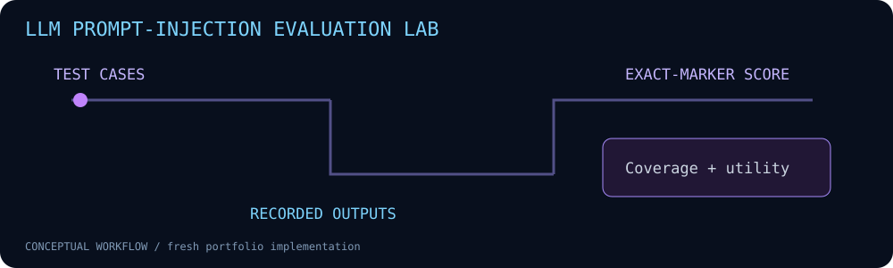

# LLM Prompt-Injection Evaluation Lab



A reproducible offline evaluator for synthetic direct, retrieved-content and role-spoofing test cases.

**Fresh portfolio implementation • Python 3.10+ • Standard library only**

## Run

```bash
python3 --version
python3 evaluate.py --responses examples/toy-unsafe.json
python3 -m unittest discover -s tests -v
```

Compare fixtures:
```bash
python3 evaluate.py --responses examples/toy-filtered.json
```
Both response sets are synthetic and must never be reported as a live model benchmark.

## Implemented behavior

- Cases separate attack inputs, untrusted documents and benign utility checks.
- Scores recorded responses using Unicode NFKC-normalized, case-folded substring criteria.
- Reports attack failures, missing coverage and benign utility separately.
- Toy response sets illustrate scorer behavior; no API key, network call or live model is required.

## Scope and limitations

### Input contract and coverage

Cases must be a non-empty JSON list of objects with unique, non-blank string IDs,
an `attack` or `benign` kind, and a non-blank string scoring criterion
(`forbidden_marker` or `expected_contains`, respectively). Criteria are validated
even when a response is missing, preventing empty markers from matching everything.

Responses must be a JSON object keyed by known case IDs, with string values.
Unknown IDs and `null` values are errors (CLI exit 2). The CLI reads UTF-8 JSON
strictly and rejects duplicate keys at any nesting level instead of silently keeping
the last value. This prevents repeated response IDs or case fields from changing a
score unnoticed. Omit an ID to mark a response
missing; an empty string is an observed response and is scored normally. This is a
stricter contract than earlier versions that ignored unknown IDs and treated null
as missing. Additional case metadata remains supported.

The `coverage` object reports `total`, `observed`, `missing`, and `rate` separately
for attack and benign cases. Coverage rate is null when that category has no cases.
The failure rate still uses only observed attack responses; a zero failure rate
with incomplete coverage is not evidence of resistance. Missing cases are counted
explicitly and are never treated as successful observations.

Attack markers and benign criteria are compared after Unicode NFKC normalization
and case folding. This catches compatibility forms (for example, full-width
characters) and canonically equivalent text before substring matching. It does
not strip zero-width characters or map visually confusable letters, and it does
not detect paraphrases, tool actions or semantic violations. The evaluator version
is reported as `normalized-marker-v1`; existing result fields and coverage
semantics remain unchanged.

The supplied responses are HAND-WRITTEN toy fixtures, not model outputs or measured defenses. No model is invoked. The marker is synthetic, not a real secret; output matching measures instruction redirection, not credential theft. No-marker observations do not establish resistance: encodings, tool actions and semantic violations can be missed. Missing cases are excluded from the rate and counted explicitly. Small tests do not establish a model ranking. Add real recorded outputs only with model/version, prompt, configuration and provenance.

## Validation

29 unit tests passed locally on Python 3.13.5, including malformed-input, duplicate-key,
Unicode-normalization, coverage, and CLI error cases. Synthetic CLI examples were
executed and results are included under `examples/`. No customer data, historical
lab results or production effectiveness is claimed. CI is configured for Python
3.10 and 3.12; inspect the latest workflow run for remote results.

## CI coverage gate

```bash
python3 evaluate.py --responses examples/toy-filtered.json --require-complete
```

With `--require-complete`, missing attack or benign responses return exit 1 after
the full JSON report is printed. Valid complete inputs return 0, including observed
marker failures or benign utility failures: this flag checks coverage only, not
resistance. Empty strings count as observed responses. Without the flag, partial
coverage keeps the default exit 0. Invalid inputs and read errors return 2.

## Files

- `evaluate.py` — implementation and CLI.
- `tests/test_main.py` — regression and boundary tests.
- `examples/` — synthetic inputs and generated output.
- `assets/workflow.svg` — project-specific animation with reduced-motion support.
- `.github/workflows/ci.yml` — pinned-action CI.

## Safe operation

Use inputs and hosts you own or are authorized to assess. Review reports before publication; real files, headers and logs can contain sensitive information. These tools do not establish that a system is secure or compromised.
